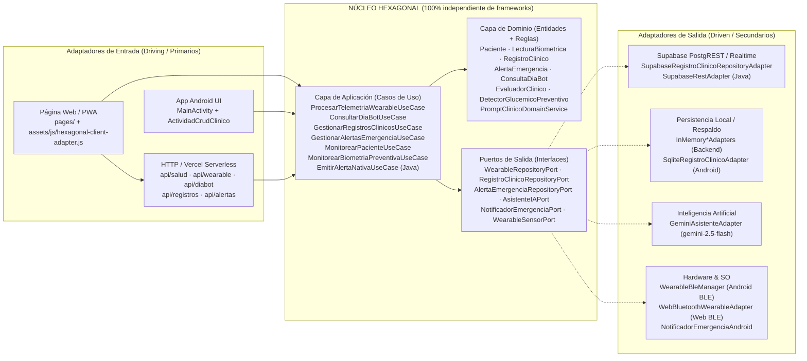

# Arquitectura Hexagonal (Puertos y Adaptadores) — DiaMon GPS Salud

**DiaMon GPS Salud (v1.3.0)** implementa **Arquitectura Hexagonal** de extremo a extremo cubriendo el **Backend (Node.js / Vercel Serverless)**, la **Aplicación Web (PWA)** y la **App Nativa Android (Java / Android Studio)**.

## Diagrama General de Capas



---

## Mapa Exacto de Archivos por Capa

### 1. Backend y Núcleo Compartido (`src/` + `api/` + `server.js`)

| Capa | Ruta | Responsabilidad |
|---|---|---|
| **Dominio — Entidades** | `src/domain/entities/` | `PacienteEntity.js`, `LecturaBiometricaEntity.js`, `RegistroClinicoEntity.js`, `AlertaEmergenciaEntity.js`, `ConsultaDiaBotEntity.js` |
| **Dominio — Servicios** | `src/domain/services/` | `EvaluadorClinicoDomainService.js` (Haversine + Glucosa + Presión), `DetectorGlucemicoPreventivoService.js`, `PromptClinicoDomainService.js` |
| **Dominio — Puertos** | `src/domain/ports/` | `TelemetriaRepositoryPort.js`, `WearableSensorPort.js`, `WearableRepositoryPort.js`, `RegistroClinicoRepositoryPort.js`, `AlertaEmergenciaRepositoryPort.js`, `AsistenteIAPort.js`, `NotificadorEmergenciaPort.js` |
| **Aplicación (Casos de Uso)** | `src/application/usecases/` | `MonitorearPacienteUseCase.js`, `MonitorearBiometriaPreventivaUseCase.js`, `ProcesarTelemetriaWearableUseCase.js`, `ConsultarDiaBotUseCase.js`, `GestionarRegistrosClinicosUseCase.js`, `GestionarAlertasEmergenciaUseCase.js` |
| **Infraestructura — Adaptadores Entrada HTTP** | `src/infrastructure/adapters/in/http/` | `WearableHttpController.js`, `DiaBotHttpController.js`, `RegistrosHttpController.js`, `AlertasHttpController.js`, `SaludHttpController.js` |
| **Infraestructura — Adaptadores Salida** | `src/infrastructure/adapters/out/` | `persistence/SupabaseRegistroClinicoRepositoryAdapter.js`, `persistence/InMemory*Adapter.js`, `ai/GeminiAsistenteAdapter.js`, `notifications/ConsoleNotificadorAdapter.js` |
| **Composition Root (DI)** | `src/infrastructure/container.js` | Ensambla todos los adaptadores e inyecta los puertos en los casos de uso (`createBackendContainer`). |
| **Entrypoints Vercel / Local** | `api/*.js` y `server.js` | Puntos de entrada delgados: `/api/salud`, `/api/wearable`, `/api/diabot`, `/api/registros`, `/api/alertas`. |

### 2. Aplicación Web / PWA (`pages/` + `assets/js/`)
- Consume los mismos módulos puros de `src/domain/` y `src/application/` en el navegador y se comunica con el backend hexagonal a través de `assets/js/hexagonal-client-adapter.js` (`window.DiaMonBackendAdapter`), con soporte offline transparente cuando se ejecuta en WebView (`file://`).

### 3. App Nativa Android (`android-studio-app/app/src/main/java/co/diamon/salud/gps/`)

| Capa | Paquete / Archivos |
|---|---|
| **Dominio (puro Java, sin `android.*`)** | `domain/entities/RegistroClinico.java`, `domain/ports/RegistroClinicoRepositoryPort.java`, `domain/ports/WearableSensorPort.java`, `domain/ports/NotificadorEmergenciaPort.java` |
| **Aplicación (puro Java, sin `android.*`)** | `application/usecases/GestionarRegistroClinicoUseCase.java`, `application/usecases/EmitirAlertaNativaUseCase.java` |
| **Infraestructura — Adaptadores Salida** | `infrastructure/adapters/sqlite/SqliteRegistroClinicoAdapter.java`, `infrastructure/adapters/supabase/SupabaseRestAdapter.java`, `infrastructure/adapters/ble/WearableBleManager.java`, `infrastructure/adapters/notifications/NotificadorEmergenciaAndroid.java` |
| **Composition Root (DI)** | `infrastructure/di/AndroidHexagonalContainer.java` |
| **Adaptadores Entrada (UI)** | `MainActivity.java`, `ActividadCrudClinico.java` |

---

## Verificación Automatizada de Pureza Arquitectónica

Ejecutar toda la suite de pruebas (incluyendo validación estática de que `domain/` y `application/` no importan infraestructura ni SDK de Android):

```bash
npm test
```
